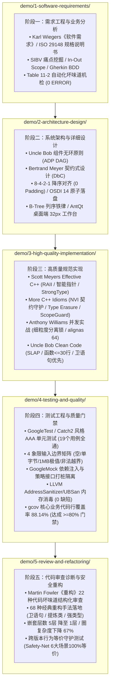

# Code-Craft 现代软件工程全生命周期 (SDLC) 实战示例库 (Demo Suites)

本目录汇总了基于 **Code-Craft 核心专业 Skills 矩阵** 演进推导的完整工业级软件工程实战范例。每个子目录均严格对应软件开发生命周期（SDLC）的标准阶段，且每一个阶段均包含：
1. **权威标准规格文档**（按照行业标准编写的正式成果物）；
2. **推导与微调过程日志**（记录从上一阶段向本阶段意图分解、技术权衡与坏味道治理过程）；
3. **自动化评估与机检工具**（可直接运行的 Python / Shell 脚本，提供 100% 实证数据）；
4. **形式化评估报告**（基于业界大师经典理论的量化验收依据）。

---

## SDLC 阶段实战目录索引

| 阶段目录 | 对应 SDLC 阶段 | 调用的核心 Skills | 核心交付成果与检验工具 |
| :--- | :--- | :--- | :--- |
| **[`1-software-requirements/`](./1-software-requirements/)** | **阶段一：需求工程与业务分析** | **`software-requirements`** | • 《FileGate 软件需求规格说明书 (SRS)》 • 需求推导与歧义微调复盘日志 • `run_lint_check.sh` 需求坏味道机检脚本 |
| **[`2-architecture-design/`](./2-architecture-design/)** | **阶段二：系统架构与详细设计** | **`code-design`** **`systems-data-design`** **`sql-craft`** **`unix-philosophy`** **`antqt`** | • 《FileGate 系统架构与详细设计说明书》 • 架构推导、解环与内存优化过程日志 • `verify_architecture_design.py` 7项自动化检验工具 • 形式化架构评估报告 (100分) |
| **[`3-high-quality-implementation/`](./3-high-quality-implementation/)** | **阶段三：高质量规范实现** | **`effective-cpp`** **`cpp-idioms`** **`cpp-concurrency`** **`ub-mode`** | • C++20 健壮源码 (`include/` + `src/`) • OSDI 14 原子落盘、盲水印、Typestate 与并发锁队列 • `filegate_demo` 可执行测试程序 (5大测试全通) • `verify_implementation_quality.py` 自动化质量体检工具 (100分) |
| **[`4-testing-and-quality/`](./4-testing-and-quality/)** | **阶段四：测试工程与质量门禁** | **`cpp-testing`** **`cpp-code-quality`** | • 19 个 AAA 边界单元测试套件 (`tests/`) • `run_quality_gate.sh` 自动化门禁流水线 • LLVM ASan/UBSan 内存深度消毒报告 (0缺陷) • `gcov` 核心源码覆盖率 88.14% 报告 |
| **[`5-review-and-refactoring/`](./5-review-and-refactoring/)** | **阶段五：代码审查诊断与安全重构** | **`code-review`** **`refactoring`** | • 《FileGate 遗留模块代码审查与质量诊断报告》 • 5 大 Fowler 坏味道诊断与 68 种重构手法演进日志 • `verify_refactoring.py` 自动化重构度量与门禁工具 • 跨版本行为等价守护测试 (Safety-Net 6大场景100%等价) |
