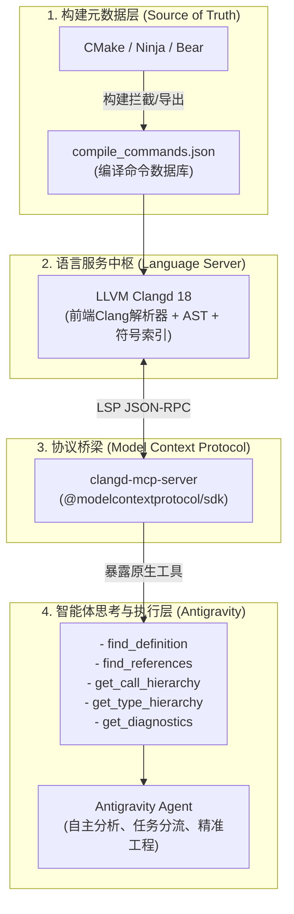

# 面向大型 C++ 工程的 AI Agent 代码智能感知与精准工程实践

> **作者**：Antigravity & Code-Craft 架构组  
> **分类**：C++ 工程效能 / AI Coding Agent / 代码智能协议  
> **适用场景**：大型 C++ 项目代码分析、架构梳理、新功能扩展、安全重构与底层性能优化  

---

## 一、 背景与行业痛点：为什么 Naive RAG 在 C++ 中必死？

在构建面向 Python、TypeScript 或 Go 等语言的 AI 代码助手时，基于向量数据库的**检索增强生成（Naive RAG）**在一定程度上能够工作。然而，当把这套方案直接套用到大型 C++ 工程时，通常会产生严重的问题：

1. **宏预处理迷宫 (`#ifdef` / `#define`)**：
   C++ 广泛使用预处理宏进行跨平台适配、功能开关（Feature Toggles）和代码生成。纯文本检索无法得知当前目标平台的有效分支代码，导致模型读取到死代码或错误分支。
2. **头文件展开与深层间接寻址**：
   C++ 的类声明、内联实现、类型别名（`using` / `typedef`）常常分散在跨越多个层级的头文件中，模板元编程与宏展开更是在编译期才能确定具体类型。
3. **隐式类型推导与虚函数动态分发**：
   对于 `auto` 变量、模板类型推导、重载函数（Overload Resolution）以及虚表（vtable）多态体系，纯文本搜索只能凭函数名模糊匹配，产生大量同名符号的误召回。
4. **编译选项（Compiler Flags）决定的 AST**：
   同一份代码在 `-std=c++17` 和 `-std=c++20` 下语义可能不同；不同的宏定义开关 `-D` 会直接颠覆语法树。

**结论**：**脱离了真实编译上下文的 C++ 代码分析，模型推理只是“凭空脑补”与“幻觉猜测”。必须为 Agent 赋予基于编译器前端的精准语义感知能力。**

---

## 二、 工业级架构解法：LSP + Compilation Database + MCP

当前软件工程界最成熟、被 Chromium、LLVM、Google Kythe 及顶级 IDE 验证的标准解法为：**“以构建系统为源头，编译数据库为纽带，Language Server (Clangd) 为语义中枢，MCP (Model Context Protocol) 为 Agent 工具桥梁”**。



### 1. 核心链路解析
* **`compile_commands.json`**：记录了项目中每一个 `.cpp` 文件的完整编译命令（包含准确的包含目录 `-I`、宏定义 `-D`、C++标准版本 `-std`）。
* **`Clangd` 语言服务器**：LLVM 原生官方维护的语言服务器，利用真实的 Clang 前端构建绝对保真的 AST，提供精确的跨文件符号跳转、类型推导和虚继承链。
* **`clangd-mcp-server`**：将 Clangd 的 LSP 协议（stdio）转换包装为 Anthropic 与 Google Antigravity 通用的 **Model Context Protocol (MCP)** 工具，让智能体按需调用，而非一次性填塞几万行代码挤爆上下文窗口。

---

## 三、 本机环境极简搭建实操

### 1. 底层工具链安装（Linux Mint / Ubuntu Noble）
```bash
sudo apt-get update && sudo apt-get install -y clangd-18 ninja-build bear nodejs npm
sudo update-alternatives --install /usr/bin/clangd clangd /usr/bin/clangd-18 100
```

### 2. 部署 `clangd-mcp-server`
将专为大型工程打造的 Node.js 版 MCP 桥接器部署在本地：
```bash
mkdir -p ~/.gemini/tools && cd ~/.gemini/tools
git clone https://github.com/felipeerias/clangd-mcp-server.git
cd clangd-mcp-server
npm install && npm run build
```

### 3. 配置全局 MCP 注册表 (`~/.gemini/config/mcp_config.json`)
```json
{
  "mcpServers": {
    "clangd": {
      "command": "node",
      "args": [
        "/home/peanut/.gemini/tools/clangd-mcp-server/dist/index.js"
      ],
      "env": {
        "CLANGD_PATH": "/usr/bin/clangd-18"
      }
    }
  }
}
```

---

## 四、 智能体自动化编排与开发 SOP

为了让 Antigravity 在进入任意 C++ 项目时“全自动触发”最佳实践，系统引入了编排技能 `cpp-code-intelligence` 与全局准则 `AGENTS.md`。

### 1. 项目准备的唯一原则：`compile_commands.json`
在项目的根目录下，只要确保存在 `compile_commands.json` 软链接：
* **CMake 项目**：
  ```bash
  cmake -B build -DCMAKE_EXPORT_COMPILE_COMMANDS=ON
  ln -sf build/compile_commands.json compile_commands.json
  ```
* **Makefile/遗留项目**：
  ```bash
  bear -- make -j$(nproc)
  ```
  *(注：智能体内置的 `setup_compile_commands.sh` 脚本可全自动识别并完成此步骤)*。

---

### 2. 三大核心开发场景的智能体 SOP

#### 场景 A：新增功能（最小侵入式扩展）
1. **接口契约锁定**：智能体调用 `find_definition` 提取基类或服务的纯虚函数、资源所有权模型（`std::unique_ptr` / 引用）与并发线程约定；
2. **开闭原则落地**：优先通过新增独立派生类或组合包装，杜绝直接在几十万行的旧巨石类中硬加 `switch-case` 或公有成员；
3. **测试防线**：依照 `cpp-testing` 编写 AAA 模式的 GoogleTest 测试用例，Debug 模式开启 ASan/UBSan 消毒剂验证内存安全。

#### 场景 B：安全重构（影响面排查）
1. **全局影响面分析 (Impact Analysis)**：在修改任何公共函数签名之前，**强制调用 `find_references`** 提取全工程所有的引用调用位置；
2. **坏味道清除**：依照 Martin Fowler 68 种标准重构手法（提取函数、以多态取代条件分支、以查询取代临时变量）小步快跑；
3. **零告警回归**：改动完成后调用 `get_diagnostics` 确保零编译器报错与零类型隐式转换警告，并回归既有测试套件。

#### 场景 C：底层性能与并发优化
1. **实证与数据驱动**：严禁无凭据猜疑，严格编写最小 Benchmark Demo 获取真实耗时（纳秒级）或吞吐量；
2. **硬件架构排查**：
   - **Cache Line 伪共享**：排查多线程写竞争，对高频原子计数添加 `alignas(64)` 内存对齐；
   - **结构体内存重排**：降序对齐成员，消除隐式 Padding；
   - **静态多态消除 vtable 开销**：将热路径中的无状态虚函数体系重构为 CRTP（Curiously Recurring Template Pattern）。

---

## 五、 总结与展望

通过将 **编译器前端能力（Clangd）** 与 **大语言模型推理能力（Antigravity）** 通过 **MCP 协议** 深度融合，我们彻底解决了 C++ 在 AI 辅助研发中的“上下文幻觉”顽疾。智能体不再是一个只能读写文本的打字机，而是化身为一位持有 AST 语法树、调用链拓扑和编译诊断工具的高级 C++ 结对架构师。
