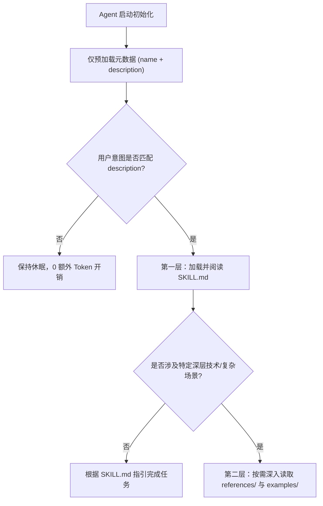

# Agent Skills 编写核心规范与速查手册 (Cheat Sheet)

> 整理自 Anthropic 官方文档：[`resources/agent-skills/best-practices.md`](./best-practices.md)
> 结合 Code-Craft 多语言实践总结。

---

## 1. 核心架构与加载机制（按需渐进式披露）



- **预加载阶段（Pre-load）**：Agent 在启动时**只会**将所有技能的 `name` 和 `description` 加载到上下文中。正文不占 Token。
- **匹配激活阶段（Activation）**：当且仅当用户提问匹配 `description` 时，Agent 才会使用文件读取工具加载 `SKILL.md`。
- **深入展开阶段（Deep References）**：`references/`、`scripts/`、`examples/` 只有在 `SKILL.md` 指引且任务确有需要时才会被按需读取。

---

## 2. 元数据编写铁律 (Frontmatter)

### 2.1 `name` 规范
- 最长 64 字符。
- 仅允许小写字母、数字和连字符（`-`）。
- 严禁下划线、空格或特殊字符。
- 推荐使用动词+名词或领域专有名词：如 `cpp-code-quality`, `sql-craft`, `systems-data-design`。

### 2.2 `description` 规范（双语双锚点公式）
- 最长 1024 字符。
- **必须采用第三人称客观陈述**（严禁以 "I can", "You should", "This skill will" 等第一/第二人称开头）。
- **必须同时包含“它做什么”与“何时使用它（触发关键词）”**。
- **推荐中英文双语双锚点结构**：

```yaml
---
name: your-skill-name
description: >-
  [英文能力定义: 动词开头第3人称，如 Analyzes..., Generates..., Optimizes...]
  Use when [英文触发场景列表，如 when optimizing queries, refactoring legacy code, formatting C++...].
  [中文能力定义: 包含核心业务域与专业术语，如 关系型数据库 Schema 设计、B-Tree 物理索引优化...]。
  当用户要求[中文触发场景列表，如 当用户要求设计表结构、排查慢查询、治理大表深分页时触发]。
---
```

---

## 3. 正文编写三大原则 (SKILL.md)

### 3.1 简洁原则（默认假设模型已经足够聪明）
- **不要解释常识**：不要解释什么是 PDF、什么是 B-Tree、什么是 HTTP 状态码。
- **只提供专属护栏与工程决策**：只写当前项目特有的约定、参数配置、容易踩坑的陷阱、具体的命令执行规范。
- 好的指令（~50 Tokens）：给命令、给模板、给关键配置。
- 坏的指令（~200 Tokens）：从背景历史讲起，解释概念。

### 3.2 恰当的自由度（Degrees of Freedom）
- **低自由度（严格脚本/护栏）**：针对易错、高危、顺序敏感操作（如数据库迁移、文件原子落盘四步法、静态检查脚本）。
- **中等自由度（模板/带参脚本）**：针对通用任务骨架，允许 Agent 根据上下文微调参数。
- **高自由度（启发式清单/思考维度）**：针对代码审查、架构设计、方案选型，提供思维核对项，让模型充分发挥推理能力。

### 3.3 目录深度铁律（一层深度）
- **严禁多层嵌套引用**：`SKILL.md` 引用 `references/foo.md` 是第一层深度；`foo.md` 内部严禁再引用 `bar.md` 去分发指令，避免模型在检索时陷入“深度递归检索迷宫”。
- 所有的专题参考手册平铺在 `references/` 目录下，并由 `SKILL.md` 直接建立索引链接。

---

## 4. 路径与跨平台防坑核对项

- **正斜杠铁律**：所有脚本、配置文件与文档中的路径必须全部使用正斜杠（`/`），严禁使用 Windows 风格的反斜杠（`\`）。
- **相对路径基准**：技能内部引用其他资源时，使用相对于当前文件的相对路径（如 `./references/xxx.md` 或 `./scripts/run.sh`）。
- **无巫术常量（No Magic Numbers）**：所有硬编码参数（如缓存对齐 64、超时时间 30s、列宽 120 列）必须在文档或注释中说明物理/工程依据。
- **错误排查与修复闭环**：关键脚本执行失败时，必须在日志中输出用户可读的明确修复指导，而不是仅抛出崩溃栈。
